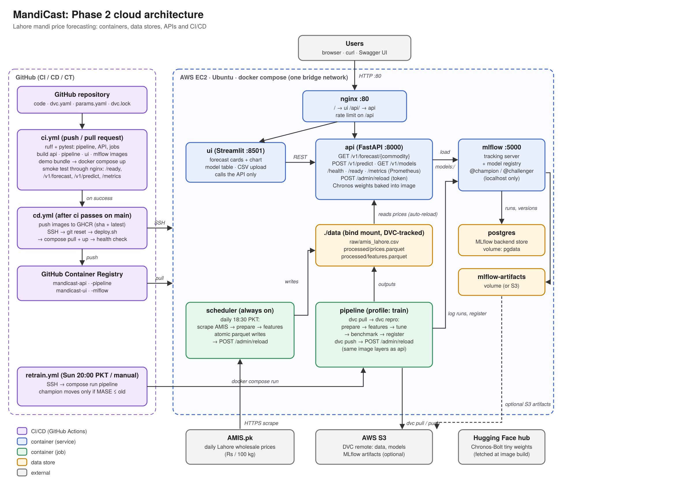

# MandiCast

Daily wholesale price forecasting for tomato, onion and potato in the Lahore mandi, built as a reproducible MLOps pipeline. MLOps course project, FAST-NU Lahore, Fall 2026.

Team: Anas Naveed Butt (23L-0764), Muhammad Ali Hadi (23L-0940), Abdul Hadi (23L-0923), Mohib Ali Khattak (23L-0763)

[](https://github.com/Anasnaveed69/mandicast/actions/workflows/ci.yml)
[](https://github.com/Anasnaveed69/mandicast/actions/workflows/cd.yml)

- **Phase 1 (ML pipeline)**: data versioning, training/evaluation pipeline, experiment tracking, model registry ([below](#what-phase-1-does)).
- **Phase 2 (cloud deployment)**: FastAPI inference server, Streamlit UI, Docker Compose stack, CI/CD with GitHub Actions to AWS EC2 ([next section](#phase-2-productionizing-and-deployment)).

Drift monitoring comes in the next phase.

## Phase 2: productionizing and deployment



### Services (`docker-compose.yml`)

| Service | Image | What it does |
|---|---|---|
| `nginx` | nginx:1.27-alpine | the only public port (80): `/` goes to the UI, `/api/` to the API |
| `api` | `mandicast-api` (docker/app.Dockerfile, target `api`) | FastAPI. Loads `models:/mandicast-<commodity>-h<h>@champion` from the MLflow registry and serves forecasts from the latest prices |
| `ui` | `mandicast-ui` | Streamlit dashboard: today's price, 1 and 7 day forecasts, history chart, models in production, forecast from an uploaded CSV |
| `mlflow` | `mandicast-mlflow` | tracking server and model registry (Postgres backend, artifacts on a volume or S3), localhost only |
| `postgres` | postgres:16-alpine | MLflow backend store |
| `scheduler` | `mandicast-pipeline` (target `pipeline`) | every day at 18:30 PKT: scrape AMIS, rebuild `prices.parquet` / `features.parquet` (atomic writes), tell the API to reload |
| `pipeline` | `mandicast-pipeline` | one-off job (profile `train`): `dvc pull`, `dvc repro` against the MLflow server, `dvc push`, API reload |

`api` and `pipeline` are two targets of one Dockerfile, so the models are trained and served with the same library versions. Torch is the CPU build, the Chronos-Bolt weights are baked into the API image at build time, and every container runs as a non-root user with a health check.

### Inference API

Interactive docs: `http://<host>/api/docs`.

| Method | Path | |
|---|---|---|
| GET | `/v1/forecast` | latest forecast for every commodity and horizon |
| GET | `/v1/forecast/{commodity}?horizon=7` | one commodity (`tomato`, `onion`, `potato`; horizon 1 or 7) |
| POST | `/v1/predict` | forecast from a price history you send |
| GET | `/v1/prices/{commodity}?days=90` | cleaned prices the forecasts are based on |
| GET | `/v1/models` | which registry version / model family is serving each forecast |
| GET | `/health`, `/ready` | liveness; readiness (503 until models and data are loaded) |
| GET | `/metrics` | Prometheus metrics (requests, latency, forecasts served, data age) |
| POST | `/admin/reload` | reload models from the registry (header `X-Admin-Token`) |

```bash
curl http://<host>/api/v1/forecast/tomato?horizon=7
# {"data_last_date": "2026-11-13", "forecasts": [{"commodity": "tomato", "horizon": 7,
#   "origin_date": "2026-11-13", "target_date": "2026-11-20", "yhat": 7200.0, "q10": null, "q90": null,
#   "unit": "Rs/100kg", "model": {"name": "mandicast-tomato-h7", "version": "1", "model": "naive", ...}}]}

curl -X POST http://<host>/api/v1/predict -H 'Content-Type: application/json' \
  -d '{"commodity": "onion", "horizon": 7, "history": [{"date": "2026-10-01", "price": 6100}, ...]}'
```

Forecasts from the stored data are cached per model version and data date. The price file is reloaded when it changes, and `/admin/reload` swaps models without a restart. If the registry can't be reached at start-up, the API keeps retrying in the background and reports why in `/ready`.

### Run it locally

```bash
cp .env.example .env
docker compose up -d --build                         # http://localhost  (UI)  ·  http://localhost/api/docs
docker compose --profile train run --rm pipeline     # train + register into the MLflow server
# MLflow UI: http://localhost:5000
```

Without the real data, or before anything is registered, the stack can run on a synthetic demo bundle (this is also what CI uses):

```bash
docker compose build api
docker run --rm -v "$PWD/demo:/out" ghcr.io/anasnaveed69/mandicast-api:latest python -m mandicast.demo --out /out
MODEL_SOURCE=local DATA_DIR=./demo/data SERVING_DIR=./demo/models/serving docker compose up -d nginx
```

`python -m mandicast.export` copies the current champions from the registry into `models/serving/`, so the API can also run with `MODEL_SOURCE=local` and no MLflow server.

### CI/CD

| Workflow | Trigger | Steps |
|---|---|---|
| `ci.yml` | push to main, pull request | ruff, pytest (pipeline, API and job tests); build all four images; start api + ui + nginx on a demo bundle and smoke-test through nginx (`/ready`, `/v1/forecast`, `/v1/predict`, `/metrics`, UI health) |
| `cd.yml` | `ci` passed on main, or manual | push images to GHCR tagged with the commit SHA and `latest`; SSH to EC2, check out the same commit, `deploy/deploy.sh` (pull, `up -d`, wait for health); public smoke test |
| `retrain.yml` | Sundays 20:00 PKT, or manual | SSH to EC2 and run the `pipeline` job; `register` moves `@champion` only if the new model's MASE is at least as good |

Deployment steps (EC2 setup, secrets, data bootstrap) are in [docs/deployment.md](docs/deployment.md).

## What Phase 1 does

```
AMIS.pk ──scrape/import──> data/raw/amis_lahore.csv   (dvc add, pushed to S3)
                                   │
                prepare ───────────┤  clean daily series per commodity, fill short gaps, fix one-day typos
                features ──────────┤  log-return lags, rolling stats, calendar + Ramadan/Eid flags
                tune ──────────────┤  Optuna search for XGBoost (only on data before the test folds)
                benchmark ─────────┤  walk-forward backtest of every model family -> MLflow
                register ──────────┘  best model per commodity x horizon -> MLflow Model Registry
```

All five stages are in `dvc.yaml`, so `dvc repro` reruns only what changed and `dvc.lock` pins the exact data, code and params behind every result.

**Models compared** (same folds, same metrics):

| Model | Family | Notes |
|---|---|---|
| Naive, Seasonal naive | baseline | last value / same weekday last year |
| Linear (ridge) | classical | lag + calendar features |
| XGBoost | gradient boosting | quantile objective (10/50/90%), Optuna-tuned |
| PatchTST | transformer, trained | written in PyTorch, one global model over the three series, pinball loss |
| Chronos-Bolt (tiny) | transformer, pretrained | zero-shot from Hugging Face, no training on our data |

TFT and Chronos fine-tuning are planned for the next phase.

**Evaluation:** expanding-window walk-forward (5 folds x 30 forecast origins by default, horizons 1 and 7 days). Metrics: MAE, RMSE, MAPE, MASE (scaled by the h-step naive error on the training part), pinball loss and 80% interval coverage for the quantile models, plus fit time and prediction latency.

## Phase 1 results

Data: AMIS Lahore, 1 Jan 2025 to 13 Nov 2026 (682 days, 10 days with no report). Walk-forward test origins run from June to November 2026. Full numbers are in `reports/benchmark.csv` and in MLflow.

| Commodity | Horizon | Best model | MAPE % | MASE | Runner-up |
|---|---|---|---|---|---|
| Onion | 1 day | naive | 3.12 | 2.31 | XGBoost (3.12) |
| Onion | 7 days | Chronos-Bolt (zero-shot) | 8.69 | 1.70 | PatchTST (8.92) |
| Potato | 1 day | naive | 2.52 | 0.94 | XGBoost (2.52) |
| Potato | 7 days | naive | 7.10 | 0.84 | XGBoost (7.13) |
| Tomato | 1 day | naive | 6.32 | 2.98 | XGBoost (6.32) |
| Tomato | 7 days | naive | 19.42 | 2.41 | XGBoost (19.48) |

What this says so far:
- Day-ahead, mandi prices are very sticky (the same price is often posted several days in a row), so "tomorrow = today" is very hard to beat. XGBoost ties it but doesn't beat it.
- At 7 days the gap opens up a bit and the pretrained Chronos model wins on onion without any training on our data. PatchTST is held back by the short history (under two years).
- MASE above 1 for onion and tomato means the test months (Jun-Nov 2026) were more volatile than the training period, not that the models are worse than naive.
- Data issue found on the way: AMIS stops listing "Potato Fresh" in Lahore for months at a time and lists "Potato Sugar free" instead; `prepare` fills those long gaps from the second variety (147 of 682 days).

Next phase: more history, TFT and Chronos fine-tuning, and adding volatility-aware features so the 7-day models can do better than persistence.

## Repo layout

```
mandicast/
  scrape.py        AMIS daily scraper + importers for saved pages / csv
  prepare.py       cleaning
  features.py      feature engineering (Ramadan/Eid via the Hijri calendar)
  evaluation.py    walk-forward folds and metrics
  backtest.py      runs a model over the folds
  tune.py          Optuna for XGBoost
  benchmark.py     all models -> MLflow + reports/
  register.py      winners -> MLflow registry (champion/challenger aliases)
  serving.py       MLflow pyfunc wrapper, same interface for every model family
  models/          baselines, tabular (linear, xgboost), patchtst, chronos
  api/             FastAPI inference server (settings, model/price stores, routes)
  jobs.py          scheduled refresh / retrain jobs for the containers
  export.py        registry champions -> self-contained serving bundle
  demo.py          synthetic data + model bundle for CI and first runs
ui/                Streamlit dashboard
docker/            Dockerfiles (app: api + pipeline targets, ui, mlflow) and nginx config
deploy/            EC2 setup and deploy scripts used by the CD workflow
docs/              architecture diagram, deployment guide
docker-compose.yml the production stack
tests/             unit tests (no real data needed, includes look-ahead leakage tests)
params.yaml        every setting used by the pipeline
dvc.yaml           pipeline definition
```

## Setup

Python 3.11 or 3.12.

```bash
python -m venv .venv
source .venv/bin/activate          # Windows: .venv\Scripts\activate
pip install -r requirements.txt -r requirements-dev.txt
pytest -q
```

### Data versioning (DVC + S3)

```bash
dvc remote add -d storage s3://<bucket-name>/mandicast
dvc remote modify storage region ap-south-1
aws configure                      # credentials of an IAM user with access to the bucket
```

After that, `dvc push` uploads the raw data, processed data and model outputs, and anyone can get the exact same files with `git clone` + `dvc pull`.

## Getting the data

AMIS.pk publishes daily Lahore prices in Rs/100 kg. Rows are stored in `data/raw/amis_lahore.csv` with columns `date, city, commodity_raw, min_price, max_price, fqp, source, scraped_at`; re-running any command just appends and de-duplicates.

```bash
# history: walks AMIS's "select old prices" date box one day at a time
# (~2-4 s per day; safe to stop and re-run, saved days are skipped)
python -m mandicast.scrape history --start 2025-01-01

# today's prices (this is what the daily scheduled job will run)
python -m mandicast.scrape daily --save-html data/raw/html

# pages saved by hand, or a csv that already has date / crop / price columns
python -m mandicast.scrape import-html saved/page.html
python -m mandicast.scrape import-csv old_prices.csv
```

Then version it:

```bash
dvc add data/raw/amis_lahore.csv
git add data/raw/amis_lahore.csv.dvc data/raw/.gitignore
git commit -m "data: lahore prices up to <date>"
dvc push
```

The benchmark needs at least ~1.5 years of history with the default folds (`min_train_days` + 5 x 30 days).

## Running the pipeline

```bash
dvc repro            # prepare -> features -> tune -> benchmark -> register
dvc metrics show     # data quality, best MASE per commodity/horizon, registry versions
dvc push
```

On a laptop CPU the full run takes around 10 minutes (most of it is Optuna and PatchTST). The first run downloads Chronos-Bolt tiny (~35 MB); if that fails the benchmark logs a warning and continues without it.

Outputs:
- `reports/benchmark.csv`: leaderboard per commodity and horizon
- `reports/predictions.parquet`: every backtest forecast
- `reports/benchmark_summary.json`, `reports/registry.json`: DVC metrics

## Experiment tracking

```bash
mlflow ui --backend-store-uri sqlite:///mlflow.db
```

- `mandicast-tuning`: one parent run with a nested run per Optuna trial
- `mandicast-benchmark`: one parent run per `dvc repro`, nested runs per model x commodity x horizon (params, metrics, per-fold metrics as steps, fit/predict time). The parent run has the leaderboard and forecast plots as artifacts.
- `mandicast-registry`: the refit of each winning model

## Model registry

`register` refits the best model (lowest walk-forward MASE) for each commodity and horizon on all data and registers it as `mandicast-<commodity>-h<horizon>`, e.g. `mandicast-tomato-h7`. Every version is tagged with `model`, `family`, `cv_mase`, `data_md5`, `git_commit` and `trained_until`. The `champion` alias moves to the new version only if its score is at least as good as the current champion's; otherwise it becomes `challenger`.

Every registered model is a pyfunc with the same interface, whatever the family:

```python
import mlflow
mlflow.set_tracking_uri("sqlite:///mlflow.db")
model = mlflow.pyfunc.load_model("models:/mandicast-tomato-h7@champion")
model.predict(history)   # history: DataFrame[date, commodity, price], last ~400 days
# -> commodity, origin_date, target_date, horizon, yhat, q10, q90, model
```

## Notes

- Features at date *t* only use prices up to *t*; calendar features of the target date are allowed because they are known in advance. `tests/test_features.py` and `tests/test_models.py` check this by changing future prices and asserting nothing before the cut-off moves.
- Optuna only sees data before the first benchmark fold, so XGBoost's benchmark score isn't tuned on the test periods.
- Ramadan/Eid dates use the Umm al-Qura calendar (`hijridate`). Pakistan's moon sighting is sometimes a day later, which doesn't matter much at this resolution.
